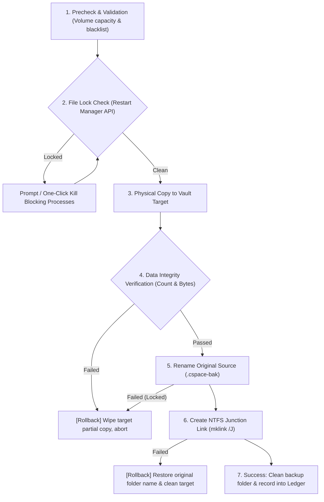

# C-Space Architecture & Technical Design

> **Project Target**: High-performance, zero-loss Windows C-drive inspection, safe cleanup, and seamless AppData migration tool.  
> **Tech Stack**: Tauri v2, Rust 2021, React 19, TypeScript, Tailwind CSS v4, Lucide Icons.

---

## 1. System Architecture Overview

The system adopts a modern decoupled desktop architecture, combining the high native throughput of Rust on Windows with the high-density component-driven rendering of React 19.


---

## 2. Core Subsystems

### 2.1 Scanner Engine (`src-tauri/src/scanner.rs`)
- **Streaming Iterator ($O(1)$ Memory Overhead)**: Uses streaming single-entry traversal (`walkdir`) with `same_file_system(true)` instead of recursive full-tree in-memory arrays, keeping memory usage constant even in massive directories.
- **Strict Reparse Point Isolation**: Evaluates `get_link_info` (via `junction::exists` and `symlink_metadata`) before stepping into subdirectories. Never traverses into Junctions or Symlinks, preventing infinite recursion and cross-volume double-counting.
- **Progressive IPC Streaming**: As individual directory statistics are resolved, results are emitted in real time via the `scan-node-found` event, rendering cards on the UI immediately without waiting for the entire disk scan to complete.

### 2.2 Cleaner Engine (`src-tauri/src/cleaner.rs`)
- **Tri-Level Risk Protection**:
  - 🟢 **Safe**: Caches, crash dumps, outdated installers.
  - 🟡 **Caution**: Build caches, old logs, shader caches.
  - 🔴 **Danger**: Core system files and personal documents are physically blocked from deletion in backend logic.
- **Locked File Skip & Real-Time Feedback**: Files locked by running processes are safely skipped without aborting the overall cleanup run. Real-time progress is broadcasted via `clean-progress`.
- **Dual Deletion Modes**: Supports moving to the Windows Recycle Bin via the `trash` crate or permanent physical deletion.

### 2.3 Transactional Migrator Engine (`src-tauri/src/migrator.rs`)
AppData migrations use an atomic transactional flow to guarantee zero data loss:



### 2.4 Lifecycle Ledger & Link Manager (`src-tauri/src/links.rs`, `src-tauri/src/ledger.rs`)
- **Persistence Store**: Managed under `%APPDATA%\com.cspace.app\ledger.json`.
- **Broken Link Detection**: Constantly inspects the validity of link virtual paths and physical target directories.
- **One-Click Reversal**: Restores migrated folders from external drives back to their exact C-drive locations seamlessly.
- **Manual Mapping Wizard**: Supports creating directory junctions (`mklink /J`), directory symlinks (`mklink /D`), file symlinks (`mklink`), and hardlinks.

---

## 3. Security Boundaries & Invariants

1. **Hardcoded Invariant Whitelist**:
   - `C:\Windows\System32`, `C:\Windows\WinSxS`, `C:\Windows\Installer`, `C:\Windows\servicing`, and root system folders are strictly prohibited from migration or automated deletion.
2. **Reparse Point Safety Guarantee**:
   - Deleting a Junction only removes the reparse tag in the directory metadata; the actual files on the target drive are never affected.
3. **Privilege Manifest Strategy**:
   - **Dev Mode**: Uses `app.dev.manifest` (`asInvoker`) for instant debugging without continuous UAC interruptions.
   - **Release Mode**: Uses `app.manifest` (`requireAdministrator`) to guarantee native privileges for low-level system Junction creation and process unlocking.

---

## 4. Directory & Module Structure

```text
C-Space/
├── src/                          # React 19 Frontend
│   ├── pages/
│   │   ├── ExplorerView.tsx      # C-drive progressive tree & inspection
│   │   ├── CleanerView.tsx       # Safe cleanup & real-time progress stream
│   │   ├── MigratorView.tsx      # AppData migration & recommendations
│   │   ├── LinksView.tsx         # Link ledger & lifecycle management
│   │   └── SettingsView.tsx      # Preferences & rule search
│   ├── types.ts                  # Shared IPC contract types
│   ├── utils.ts                  # Capacity formatting helpers
│   └── App.tsx                   # Main layout container
│
└── src-tauri/                    # Rust Backend
    ├── rules/                    # Fingerprint rulesets (R1–R12)
    │   ├── system.json           # Windows OS, drivers & logs
    │   ├── dev_browser.json      # Dev toolchains, IDEs & browsers
    │   └── apps.json             # Social, office, media & games
    ├── src/
    │   ├── scanner.rs            # Progressive low-memory scanner
    │   ├── cleaner.rs            # Cleanup engine & real-time progress
    │   ├── migrator.rs           # Transactional migrator & rollback
    │   ├── links.rs              # Windows Junction & symlink management
    │   ├── winapi.rs             # Restart Manager & Win32 system bindings
    │   ├── ledger.rs             # Local JSON ledger & settings store
    │   ├── rules.rs              # Rule matching & path macro expansion
    │   └── lib.rs                # Tauri command registration & app lifecycle
    ├── Cargo.toml                # Rust crate definitions
    └── tauri.conf.json           # Tauri v2 configuration
```

